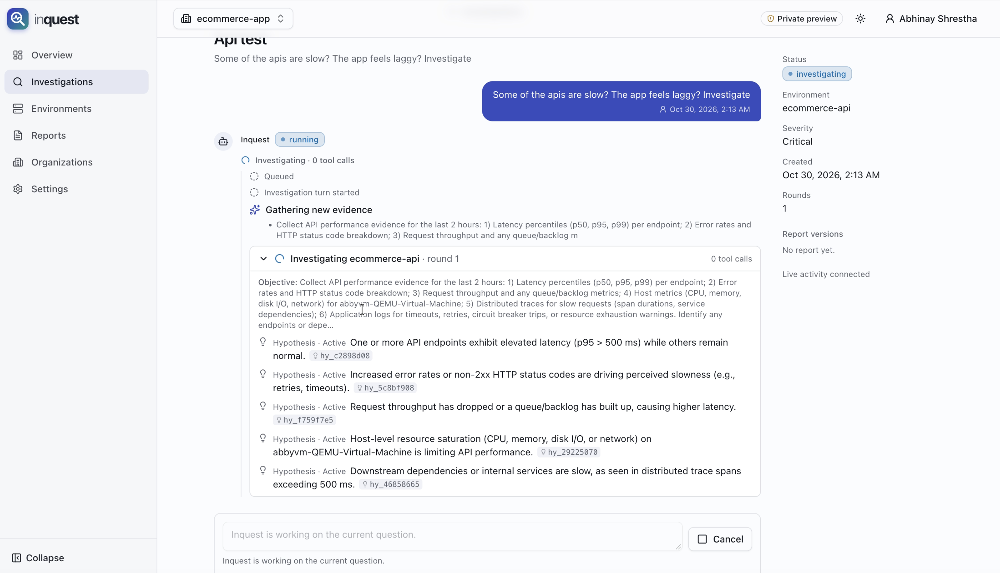
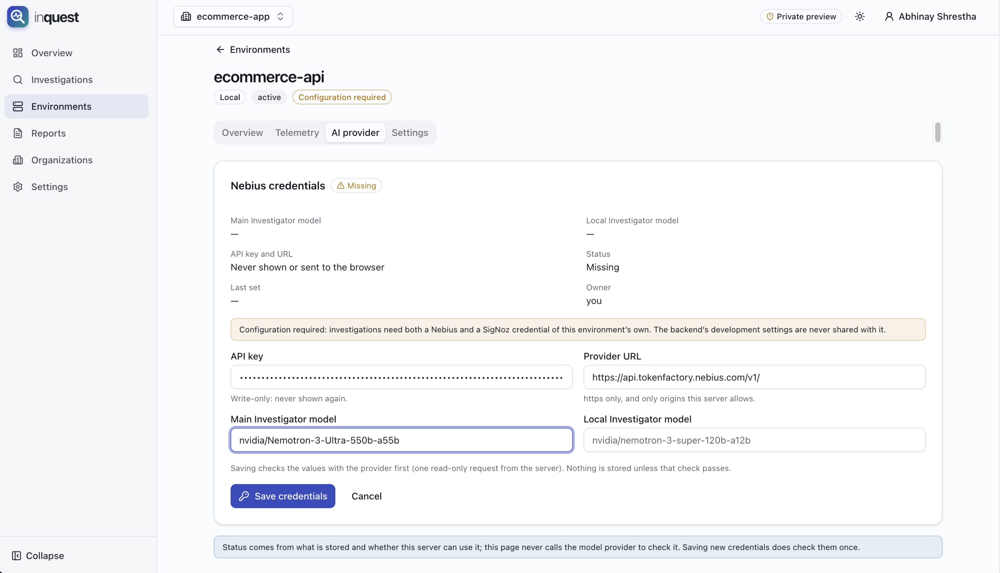
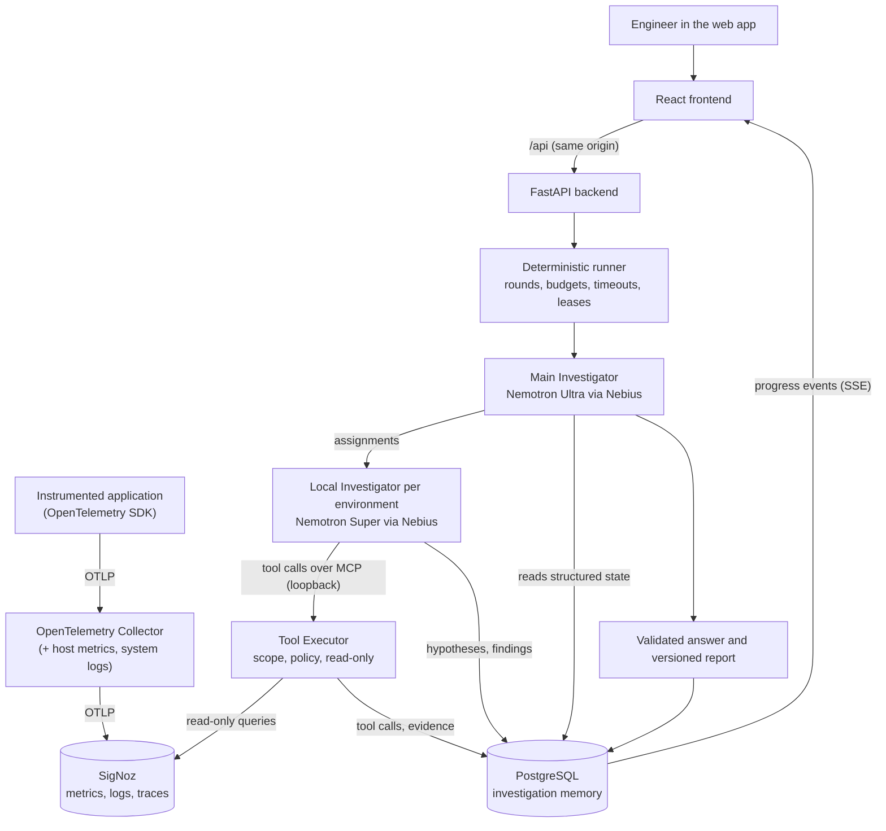

# Inquest

**Inquest is an autonomous, conversational infrastructure investigator.** Ask it why
something broke and it investigates the way an on-call engineer does. It forms hypotheses,
runs targeted read-only queries against your telemetry, records evidence, and tests and
discards hypotheses. It answers with a root-cause report in which every claim links back
to the evidence behind it. You can then ask follow-up questions in the same investigation.

The reasoning is done by **NVIDIA Nemotron models on Nebius Token Factory**. The evidence
comes from **SigNoz** (OpenTelemetry metrics, logs and traces). Everything the
investigators find is stored in **PostgreSQL** as investigation memory.

Inquest is an investigation system, not an observability platform. It does not replace
SigNoz, Datadog or any other telemetry backend. It never copies your telemetry into its
own database and never sends all of it to a model. It asks specific questions and keeps
the answers.

## Table of contents

1. [What Inquest does](#what-inquest-does)
2. [Screenshots](#screenshots)
3. [Features](#features)
4. [Architecture](#architecture)
5. [Quick start](#quick-start)
6. [Prerequisites](#prerequisites)
7. [Installing and Configuring SigNoz](#installing-and-configuring-signoz)
8. [Installing OpenTelemetry Collector on Ubuntu](#installing-opentelemetry-collector-on-ubuntu)
9. [Connecting Your Node.js Application to SigNoz and Inquest](#connecting-your-nodejs-application-to-signoz-and-inquest)
10. [Application traces, logs and metrics](#application-traces-logs-and-metrics)
11. [Host and service naming](#host-and-service-naming)
12. [Backend setup](#backend-setup)
13. [Frontend setup](#frontend-setup)
14. [Nebius Token Factory configuration](#nebius-token-factory-configuration)
15. [Creating an Inquest environment](#creating-an-inquest-environment)
16. [Running a real investigation](#running-a-real-investigation)
17. [Local development vs AWS deployment](#local-development-vs-aws-deployment)
18. [End-to-end verification](#end-to-end-verification)
19. [Troubleshooting](#troubleshooting)
20. [Testing](#testing)
21. [Repository structure](#repository-structure)
22. [Security](#security)
23. [Project status](#project-status)
24. [License](#license)
25. [Live demo](#live-demo)

## What Inquest does

You ask questions in plain language, for example:

- Why is my API slow?
- Why is checkout failing?
- Which endpoint has the highest latency?
- Are database queries causing the slowdown?
- When did the errors begin?
- What evidence supports the root-cause conclusion?

An investigation then runs like this:

1. You start an investigation in an **environment** (a set of hosts and services you
   registered) with a question.
2. The **Main Investigator** plans the investigation and decides what evidence is needed.
3. It assigns work to a **Local Investigator** for the environment.
4. The Local Investigator calls **MCP tools** that query SigNoz.
5. A deterministic **Tool Executor** runs every tool call. It enforces read-only access,
   forces the environment's host/service scope onto every query, and applies time and
   size limits.
6. Every tool call, evidence record, hypothesis and finding is stored in **PostgreSQL**.
7. The Main Investigator reads those structured findings and correlates them. If
   something is missing, it asks for another bounded round of investigation.
8. Inquest writes an answer and a **versioned report** whose citations are validated
   against stored evidence.
9. You ask follow-up questions in the same conversation.
10. For each follow-up, Inquest either answers from stored evidence or runs another
    bounded investigation.

"Inconclusive" is an accepted outcome. Inquest refuses to claim a root cause that the
evidence does not support.

## Screenshots

**Overview:** stored investigations, environments and report versions.


**A running investigation:** the plan, the Local Investigator's objective and its active
hypotheses, streamed live.



**Per-environment AI provider settings:** the Nebius API key is write-only and both
models are checked against the provider before anything is saved.



## Features

- **Conversational investigations.** Every question is a turn in an investigation that
  stays open for follow-ups.
- **Two-level reasoning.** A Main Investigator (Nemotron Ultra) coordinates and correlates.
  Local Investigators (Nemotron Super) gather evidence per environment.
- **Read-only, scoped telemetry tools:** `signoz.trace_stats`, `signoz.search_spans`,
  `signoz.get_trace`, `signoz.search_logs`, `signoz.log_volume`, `signoz.query_metrics`.
- **Evidence-backed reports.** Every citation is validated, earlier report versions stay
  available, and "inconclusive" is allowed.
- **Live activity.** Progress events reach the browser over Server-Sent Events.
- **Deterministic charts and numbers.** They are built from stored evidence, never from
  model text.
- **Organizations, roles and invitations,** with OpenID Connect sign-in and server-side
  sessions.
- **Per-environment credentials** for Nebius and SigNoz, encrypted at rest and never
  returned to the browser.
- **Budgets and limits** on rounds, model calls, tokens, tool calls, wall-clock time,
  concurrency, request rates and quotas.

## Architecture

Inquest sits downstream of your existing telemetry pipeline. Applications never send
anything to Inquest. They send telemetry to SigNoz, and Inquest queries SigNoz.



| Component | Responsibility |
| --- | --- |
| OpenTelemetry SDK | Runs inside your application. Creates spans, metrics and (with a supported logging library) log records and exports them over OTLP. |
| OpenTelemetry Collector | Receives OTLP from applications, scrapes host metrics, tails system log files, batches everything and exports it to SigNoz. |
| SigNoz | Stores and queries raw and historical telemetry. Inquest reaches it only through `POST /api/v5/query_range` (and a health check). |
| FastAPI backend | API, sign-in, organizations, credentials, investigations, SSE progress, and the in-process investigation runner. |
| PostgreSQL | Inquest's investigation memory: environments, investigations, turns, assignments, tool calls, evidence, hypotheses, findings, reports, progress events. Also LangGraph checkpoints. **No raw telemetry.** |
| MCP server | Tool server for the investigators. Listens on its own loopback-only port (`127.0.0.1:8001` by default) and is never exposed through the API or the browser. Each call carries a short-lived token bound to one assignment. |
| Tool Executor | The only path from a model to telemetry. Validates arguments, forces the environment's scope, limits time ranges and result sizes, redacts secrets, and records every attempt as a tool call (and every non-empty result as evidence). |
| LangGraph | Orchestrates the Main and Local Investigator graphs. Checkpoints live in PostgreSQL so interrupted turns can be recovered. |
| Main Investigator | Plans, assigns work, reads structured state, correlates, decides on follow-up rounds, and writes the answer and report. Never queries infrastructure. |
| Local Investigator | Investigates one environment: forms hypotheses, calls tools, records findings. |
| Nebius Token Factory | Hosts the Nemotron models behind an OpenAI-compatible API. |
| React frontend | Investigations, live activity, reports, environments, credentials and organizations. Renders answers from validated blocks, never raw model HTML. |

**Telemetry storage and investigation memory are separate.** SigNoz keeps the raw data and
remains your source of truth. PostgreSQL keeps only what the investigation produced:
which queries ran, small evidence summaries, hypotheses, findings and reports.

What the models may do is decided by code, not by the models:

- **Tool Executor.** All tools are read-only. Arguments are structured (no free-form query
  strings), and the environment's hosts or services are always the first term of the
  filter. The look-back is limited to 7 days. Each assignment is limited to 40 calls,
  20 rejections, 3 concurrent calls and a 20-second deadline per call.
- **Budgets and lifecycle.** The runner owns rounds, model calls, tool-call and token
  budgets, timeouts, retries, cancellation and crash recovery.
- **Grounded answers.** Answers and reports may only cite evidence, findings and
  hypotheses that exist. The backend validates every reference.
- **Follow-ups.** The Main Investigator decides whether stored memory answers a new
  question or new evidence is needed. A changed report becomes a new version; earlier
  versions stay.

## Quick start

The shortest path to a running Inquest on your machine. For a **real investigation** you
also need a reachable SigNoz with telemetry from some application, and a Nebius Token
Factory API key. The later sections explain each part in detail.

You need Python 3.12 with [uv](https://docs.astral.sh/uv/), Node 22+ with Corepack, and
Docker.

```bash
git clone https://github.com/abhinayshrestha/inquest.git
cd inquest
git checkout dev          # the setup in this guide is for the dev branch
cp .env.example .env
```

Edit `.env` (placeholders in `<angle brackets>`; never commit real values):

```dotenv
POSTGRES_PASSWORD=<any local password>
INQUEST_RUNNER_ENABLED=true
MCP_TOKEN_SECRET=<output of: openssl rand -base64 48>

# Sign-in through the bundled local mock identity provider (local only)
INQUEST_AUTH_ISSUER=http://localhost:8090/default
INQUEST_AUTH_CLIENT_ID=inquest-local
INQUEST_AUTH_CLIENT_SECRET=<any value>
INQUEST_AUTH_COOKIE_SECURE=false

# Credential encryption (generate each key separately, see below)
INQUEST_CREDENTIAL_KEYS={"k1":"<key 1>"}
INQUEST_CREDENTIAL_ACTIVE_KEY=k1
INQUEST_CREDENTIAL_FINGERPRINT_KEY=<key 2, different from key 1>

# Only if SigNoz runs on this machine (private and http origins must be listed)
INQUEST_TELEMETRY_ALLOWED_ORIGINS=["http://localhost:8080"]
```

Generate each credential key with:

```bash
uv run python -c "import base64, os; print(base64.b64encode(os.urandom(32)).decode())"
```

Start everything (two terminals):

```bash
# Terminal 1: database, mock sign-in, backend
docker compose --profile demo up -d        # PostgreSQL on :5433, mock OIDC on :8090
uv sync
uv run alembic upgrade head
uv run uvicorn src.main:app --port 8000    # API on :8000; MCP starts on 127.0.0.1:8001

# Terminal 2: frontend
cd web
corepack enable pnpm
pnpm install
pnpm dev                                   # http://localhost:5173
```

Open <http://localhost:5173>, sign in through the mock provider, create an organization
and an environment, and enter the SigNoz and Nebius credentials on the environment's
tabs. [Creating an Inquest environment](#creating-an-inquest-environment) walks through
it.

## Prerequisites

| What | Where it runs | Why |
| --- | --- | --- |
| Python 3.12 and [uv](https://docs.astral.sh/uv/) | Inquest machine | Backend (`requires-python >= 3.12`; `.python-version` pins 3.12). Use uv, not pip. |
| Node.js 22.22+ with Corepack | Inquest machine | Frontend (`web/package.json` pins `pnpm@10.34.7`). |
| Docker with Compose v2 | Inquest machine | Local PostgreSQL 16 and the mock identity provider. |
| A SigNoz instance | Anywhere reachable from the backend | Telemetry storage and query. Self-hosted or SigNoz Cloud. |
| OpenTelemetry Collector Contrib | Each monitored host | Host metrics, system logs and an OTLP endpoint for your applications. |
| An instrumented application | Monitored host | Something to investigate. A Node.js example follows below. |
| A Nebius Token Factory API key | Entered in the Inquest UI | Access to the Nemotron models. |

A typical development layout uses two machines, but everything can also run on one:

```text
Developer machine (macOS/Linux)          Ubuntu VM or server
--------------------------------         -------------------------------
Inquest frontend   :5173                 Node.js app            :3000
Inquest backend    :8000 (MCP :8001)     OpenTelemetry Collector :4317/:4318 (loopback)
PostgreSQL (Docker):5433                       |
SigNoz (Docker)    :8080, OTLP :4317  <--------+  OTLP gRPC export
```

## Installing and Configuring SigNoz

[SigNoz](https://signoz.io) is an open-source observability backend built on
OpenTelemetry and ClickHouse. Inquest needs it because it is where the evidence lives:
every tool an investigator can call is a read-only SigNoz query.

Inquest uses SigNoz's v5 query API (`POST /api/v5/query_range`) and its health endpoint
(`GET /api/v1/health?live`). It was developed and tested against self-hosted **SigNoz
v0.145–v0.148**. Older releases without the v5 query API will not work.

### 1. Install SigNoz with Docker

Installation steps change between SigNoz releases. Follow the official guide for your
version: <https://signoz.io/docs/install/docker/>. At the time of writing, the
self-hosted Docker install is:

```bash
# On the machine that will host SigNoz (needs Docker and several GB of free memory)
git clone -b main https://github.com/SigNoz/signoz.git
cd signoz/deploy/docker
docker compose up -d --remove-orphans
docker compose ps        # wait until the containers are running/healthy
```

If the official guide now uses a different installer, use that. Inquest only needs the
UI/API address and the OTLP ports described below.

### 2. Open the UI and create the first account

Open `http://<signoz-host>:8080` (`http://localhost:8080` on the same machine). On a new
instance, the first visit asks you to create the admin account and organization.

### 3. Create a read-only API key for Inquest

Inquest needs an API key with the **Viewer** role. In recent SigNoz versions:
**Settings → Service Accounts**, create a service account with the Viewer role, then
create a key for it. Older versions have **Settings → API Keys** instead, with a role
selector. Copy the key once and keep it out of files that get committed. You will paste
it into the Inquest UI.

### 4. Know which address is which

These addresses are **not interchangeable**:

| Address | Example | Used by |
| --- | --- | --- |
| SigNoz UI | `http://localhost:8080` | You, in a browser. |
| SigNoz API (what Inquest needs) | `http://localhost:8080` (same origin as the UI in current self-hosted releases) | The Inquest backend. Enter this as **SigNoz URL** in Inquest. |
| SigNoz API from another container | `http://signoz:8080` | Only for a backend container on the same Docker network as SigNoz. `signoz` is a Docker DNS name and does not resolve on your host. |
| OTLP gRPC ingest | `<signoz-host>:4317` | Collectors exporting to SigNoz. Not an HTTP API; Inquest never uses it. |
| OTLP HTTP ingest | `http://<signoz-host>:4318` | Collectors or SDKs exporting over HTTP. Inquest never uses it. |
| Your collector's OTLP endpoint | `http://localhost:4318` on the app host | Your application's SDK. |
| Inquest API | `http://localhost:8000` (dev) | The Inquest frontend, through its `/api` proxy. Has nothing to do with telemetry ingest. |

`localhost` always means "this machine, from where the request starts". From the Inquest
backend on your laptop, `localhost:8080` is SigNoz on the laptop. From a Node app inside
a container, `localhost:4318` is the container itself, not the collector (see
[Host and service naming](#host-and-service-naming)).

### 5. Allow the SigNoz address in Inquest

The backend only connects to telemetry endpoints its destination policy allows:

- **Public `https://` endpoints** (for example SigNoz Cloud) are allowed by default.
- **Private, loopback or `http://` endpoints** must be listed exactly (scheme, host, port)
  in `.env`:

  ```dotenv
  INQUEST_TELEMETRY_ALLOWED_ORIGINS=["http://localhost:8080"]
  # or, for SigNoz on another machine on your LAN:
  # INQUEST_TELEMETRY_ALLOWED_ORIGINS=["http://192.168.64.1:8080"]
  ```

Restart the backend after changing `.env`.

### 6. Verify the API

```bash
SIGNOZ_URL=http://localhost:8080

# Health, including ClickHouse reachability: expect {"status":"ok"} and HTTP 200
curl -sS "$SIGNOZ_URL/api/v1/health?live"

# A key-authenticated query: span counts per service over the last 15 minutes
read -rs SIGNOZ_API_KEY      # paste the key; it is not echoed or saved in history
END=$(( $(date +%s) * 1000 )); START=$(( END - 15 * 60 * 1000 ))
curl -sS -X POST "$SIGNOZ_URL/api/v5/query_range" \
  -H "SIGNOZ-API-KEY: $SIGNOZ_API_KEY" -H 'Content-Type: application/json' \
  -d '{"schemaVersion":"v1","start":'"$START"',"end":'"$END"',"requestType":"scalar",
       "compositeQuery":{"queries":[{"type":"builder_query","spec":{"name":"A",
       "signal":"traces","aggregations":[{"expression":"count()"}],
       "groupBy":[{"name":"service.name","fieldContext":"resource"}]}}]}}'
unset SIGNOZ_API_KEY
```

A JSON response with `"status":"success"` means the key works. A 401/403 means the key
or its role is wrong. HTML instead of JSON means the URL points at something other than
the SigNoz API. When you save the SigNoz credential in Inquest, the backend runs a similar
query (a five-minute log count) and stores nothing unless it succeeds.

## Installing OpenTelemetry Collector on Ubuntu

The collector runs on each host you want to investigate. It receives OTLP from your
applications, scrapes host metrics, optionally tails system logs, and exports everything
to SigNoz.

> These steps use the upstream `otelcol-contrib` Debian package. They were not run as
> part of writing this README. Validate your config with the commands below. The receiver
> and exporter names are standard in current releases, but check the
> [collector documentation](https://opentelemetry.io/docs/collector/) if your version
> reports a deprecation.

### 1. Download and install

Pick a release from
<https://github.com/open-telemetry/opentelemetry-collector-releases/releases> and match
your CPU architecture (`amd64` or `arm64`):

```bash
# On the Ubuntu host
OTELCOL_VERSION=<version without the leading v, e.g. from the releases page>
ARCH=$(dpkg --print-architecture)          # amd64 or arm64
wget "https://github.com/open-telemetry/opentelemetry-collector-releases/releases/download/v${OTELCOL_VERSION}/otelcol-contrib_${OTELCOL_VERSION}_linux_${ARCH}.deb"
sudo dpkg -i "otelcol-contrib_${OTELCOL_VERSION}_linux_${ARCH}.deb"

otelcol-contrib --version
systemctl status otelcol-contrib --no-pager
```

The package installs:

- the binary `otelcol-contrib`;
- a systemd unit `otelcol-contrib`, running as the user `otelcol-contrib`;
- the config file `/etc/otelcol-contrib/config.yaml`;
- `/etc/otelcol-contrib/otelcol-contrib.conf`, the unit's environment file.

### 2. Configure

Replace `/etc/otelcol-contrib/config.yaml` with the following config. It covers a single
host whose collector exports to SigNoz on another machine on a trusted network
([Pattern B](#pattern-b--collector-on-a-separate-machine-signoz-remotely-hosted) without
TLS). Replace `<signoz-host>`.

```yaml
receivers:
  # Your applications send OTLP here. Loopback only: never expose an unauthenticated
  # receiver to a network.
  otlp:
    protocols:
      grpc:
        endpoint: 127.0.0.1:4317
      http:
        endpoint: 127.0.0.1:4318

  # Host metrics. Inquest's metric presets read system.cpu.time, system.memory.usage,
  # system.cpu.load_average.1m, system.disk.io, system.disk.operations,
  # system.filesystem.usage and system.network.io/errors/dropped, which these scrapers
  # produce by default.
  hostmetrics:
    collection_interval: 30s
    scrapers:
      cpu: {}
      memory: {}
      load: {}
      disk: {}
      filesystem: {}
      network: {}
      paging: {}

  # Optional: system logs (Inquest's host-identity log tools search these).
  filelog/system:
    include: [/var/log/syslog, /var/log/auth.log]
    start_at: end

processors:
  memory_limiter:
    check_interval: 1s
    limit_percentage: 80
    spike_limit_percentage: 25
  # Stamps host.name on host metrics and file logs. override: false keeps the host.name
  # an application already set.
  resourcedetection:
    detectors: [system]
    system:
      hostname_sources: [os]
    override: false
  batch: {}

exporters:
  otlp/signoz:
    endpoint: <signoz-host>:4317
    tls:
      insecure: true     # plain gRPC: only on a trusted private network

service:
  pipelines:
    traces:
      receivers: [otlp]
      processors: [memory_limiter, batch]
      exporters: [otlp/signoz]
    metrics:
      receivers: [otlp, hostmetrics]
      processors: [memory_limiter, resourcedetection, batch]
      exporters: [otlp/signoz]
    logs:
      receivers: [otlp, filelog/system]
      processors: [memory_limiter, resourcedetection, batch]
      exporters: [otlp/signoz]
```

If you do not want system logs, remove `filelog/system` from the receivers and from the
logs pipeline. To read `/var/log/syslog` and `/var/log/auth.log`, the service user needs
the `adm` group:

```bash
sudo usermod -aG adm otelcol-contrib
```

Do not leave a `debug` exporter with `verbosity: detailed` in a running pipeline. It
writes every record to the journal, and on a small VM it can fill `/var/log` (and the
`filelog` receiver can then read its own output back).

### 3. Validate, start and inspect

```bash
sudo otelcol-contrib validate --config=/etc/otelcol-contrib/config.yaml
sudo systemctl restart otelcol-contrib
sudo systemctl enable otelcol-contrib
systemctl status otelcol-contrib --no-pager
sudo journalctl -u otelcol-contrib -f                     # live collector logs
sudo journalctl -u otelcol-contrib --since "10 min ago" | grep -iE "error|refused|failed"
ss -ltn | grep -E ':4317|:4318'                            # receivers listening on 127.0.0.1
```

Export errors show up in the journal as `Exporting failed` with a reason. The usual ones:

| Message contains | Meaning |
| --- | --- |
| `connection refused` | Nothing listens at `<signoz-host>:4317`, or a firewall blocks it. |
| `context deadline exceeded` | Network path or DNS problem; the collector retries and then drops data. |
| `Unauthenticated` / `PermissionDenied` | A token or ingestion key is missing or wrong (Pattern B with auth). |
| `tls: first record does not look like a TLS handshake` | `insecure: true` against a TLS endpoint, or the reverse. |

### Pattern A — Collector and SigNoz on the same machine

SigNoz's own Docker deployment already publishes OTLP on host ports `4317` and `4318`, so
a second collector on the same host cannot take those ports. Either:

- give the host collector different loopback ports and export to SigNoz locally:

  ```yaml
  receivers:
    otlp:
      protocols:
        grpc: { endpoint: 127.0.0.1:14317 }
        http: { endpoint: 127.0.0.1:14318 }
  exporters:
    otlp/signoz:
      endpoint: localhost:4317
      tls: { insecure: true }
  ```

  and start applications with `OTEL_EXPORTER_OTLP_ENDPOINT=http://localhost:14318`; or
- let applications export straight to SigNoz at `http://localhost:4318`, and use the host
  collector only for `hostmetrics` and `filelog` (drop the `otlp` receiver from it).

Keep SigNoz's published OTLP ports bound to `127.0.0.1` or firewalled if the machine is
reachable from other networks.

### Pattern B — Collector on a separate machine, SigNoz remotely hosted

The collector on the application host exports to SigNoz over the network.

- **Trusted private network (LAN, VPN, VPC):** the config above (`insecure: true`) works.
  Restrict the SigNoz host's 4317/4318 to the collector hosts (firewall or security
  group).
- **Across the internet:** use TLS and authentication. Self-hosted SigNoz's OTLP
  receiver has no authentication of its own. Put a TLS reverse proxy that checks a
  bearer token in front of it, or use a private network. Then:

  ```yaml
  exporters:
    otlp/signoz:
      endpoint: <otlp.your-domain.example>:443
      headers:
        authorization: "Bearer ${env:OTLP_INGEST_TOKEN}"
      # TLS is on by default; do not set insecure.
  ```

  For **SigNoz Cloud**, use the ingest endpoint and the `signoz-ingestion-key` header from
  your workspace's ingestion settings, as described in SigNoz's documentation.

Keep tokens out of `config.yaml`. Put them in the unit's environment file, which systemd
loads for the service:

```bash
sudo sh -c 'echo "OTLP_INGEST_TOKEN=<token>" >> /etc/otelcol-contrib/otelcol-contrib.conf'
sudo chmod 600 /etc/otelcol-contrib/otelcol-contrib.conf
sudo systemctl restart otelcol-contrib
```

Firewall summary: the collector needs outbound access to SigNoz (4317, or 443 behind a
proxy). Its own receivers stay on `127.0.0.1` and need no inbound rule.

## Connecting Your Node.js Application to SigNoz and Inquest

Applications do not send telemetry to Inquest:

```text
Node.js application
        |  OpenTelemetry SDK (OTLP/HTTP)
        v
OpenTelemetry Collector  (same host, http://localhost:4318)
        |  OTLP/gRPC
        v
SigNoz
        |  read-only queries (POST /api/v5/query_range)
        v
Inquest
```

The following is a small, separate Express project (not part of this repository) that
gives Inquest something to investigate. It has a fast endpoint, a slow endpoint and a
failing endpoint.

> This example was written for this README and not executed while writing it. Package
> APIs change: if something differs, follow the
> [OpenTelemetry JavaScript docs](https://opentelemetry.io/docs/languages/js/).

### 1. Create the project

```bash
# On the application host, outside the Inquest repository
mkdir ecommerce-api && cd ecommerce-api
npm init -y
npm install express pino @opentelemetry/api \
  @opentelemetry/sdk-node @opentelemetry/auto-instrumentations-node
mkdir src
```

`@opentelemetry/auto-instrumentations-node` bundles the HTTP, Express, `pg`, Pino and
other instrumentations, and provides a `register` entry point that starts the SDK from
environment variables. `@opentelemetry/api` is what your code uses for custom spans.

### 2. `src/server.js`

```js
const express = require('express')
const pino = require('pino')
const { trace, SpanStatusCode } = require('@opentelemetry/api')

const logger = pino()
const tracer = trace.getTracer('ecommerce-api')
const app = express()
const PORT = Number(process.env.PORT || 3000)

const products = [
  { id: 1, name: 'Keyboard', price: 49 },
  { id: 2, name: 'Monitor', price: 199 },
  { id: 3, name: 'Headset', price: 79 },
]
const sleep = (ms) => new Promise((resolve) => setTimeout(resolve, ms))

app.get('/health', (req, res) => res.json({ status: 'ok' }))

app.get('/api/products', async (req, res) => {
  // A custom child span around an application operation.
  await tracer.startActiveSpan('catalog.load', async (span) => {
    try {
      await sleep(20 + Math.random() * 30)
      span.setAttribute('catalog.size', products.length)
    } finally {
      span.end()
    }
  })
  logger.info({ count: products.length }, 'products listed')
  res.json(products)
})

app.get('/api/slow', async (req, res) => {
  const delayMs = 1500 + Math.floor(Math.random() * 1500)
  await tracer.startActiveSpan('inventory.reserve', async (span) => {
    span.setAttribute('inventory.delay_ms', delayMs)
    await sleep(delayMs)
    span.end()
  })
  logger.warn({ delay_ms: delayMs }, 'slow inventory reservation')
  res.json({ ok: true, delay_ms: delayMs })
})

app.get('/api/error', (req, res) => {
  const err = new Error('payment provider unavailable')
  const span = trace.getActiveSpan()
  span?.recordException(err)
  span?.setStatus({ code: SpanStatusCode.ERROR, message: err.message })
  logger.error({ err }, 'checkout failed')
  // The HTTP instrumentation also marks the server span as an error for any 5xx.
  res.status(500).json({ error: 'payment provider unavailable' })
})

app.listen(PORT, () => logger.info({ port: PORT }, 'ecommerce-api listening'))
```

### 3. Start it with OpenTelemetry

```bash
OTEL_SERVICE_NAME=ecommerce-api \
OTEL_EXPORTER_OTLP_ENDPOINT=http://localhost:4318 \
OTEL_EXPORTER_OTLP_PROTOCOL=http/protobuf \
OTEL_TRACES_EXPORTER=otlp \
OTEL_METRICS_EXPORTER=otlp \
OTEL_LOGS_EXPORTER=otlp \
OTEL_SEMCONV_STABILITY_OPT_IN=http \
PORT=3000 \
node --require @opentelemetry/auto-instrumentations-node/register src/server.js
```

| Variable | Meaning |
| --- | --- |
| `OTEL_SERVICE_NAME` | Sets the `service.name` resource attribute. This exact string goes into the Inquest environment's **Services**. Without it, telemetry arrives as `unknown_service:node`. |
| `OTEL_EXPORTER_OTLP_ENDPOINT` | Base URL of the collector's OTLP receiver. With `http/protobuf`, the SDK appends `/v1/traces`, `/v1/metrics` and `/v1/logs`. Use `http://localhost:14318` in Pattern A with remapped ports. |
| `OTEL_EXPORTER_OTLP_PROTOCOL` | `http/protobuf` matches the collector's HTTP receiver on 4318. (`grpc` would need port 4317.) |
| `OTEL_TRACES_EXPORTER` | `otlp`: export spans. |
| `OTEL_METRICS_EXPORTER` | `otlp`: export SDK metrics (HTTP server durations, runtime metrics). |
| `OTEL_LOGS_EXPORTER` | `otlp`: enables the SDK's log exporter. On its own it exports nothing. Records only reach it through a logging instrumentation such as Pino's (see [Application logs](#application-logs)). |
| `OTEL_SEMCONV_STABILITY_OPT_IN=http` | Makes the HTTP instrumentation emit the stable `http.server.request.duration` histogram. Inquest's `http_server_p99_seconds` metric preset queries exactly this name. |
| `PORT` | The app's own HTTP port. It is unrelated to the collector's 4318; any free port works. |

**Why `--require` and environment variables, not code?** Instrumentation works by
patching modules (`http`, `express`, `pg`, `pino`) when they are first loaded. The SDK
must start before your code `require`s them, so `--require ...register` runs first.
The resource (including `service.name`) is fixed when the SDK starts. A `.env` loaded
later by your app (for example with `dotenv`) is too late, so set these variables in the
process environment (shell, systemd unit, Docker `environment:`, PM2 ecosystem file).

### 4. Generate traffic and check SigNoz

```bash
curl -s localhost:3000/health
for i in $(seq 1 50); do curl -s -o /dev/null localhost:3000/api/products; done
for i in $(seq 1 10); do curl -s -o /dev/null localhost:3000/api/slow; done
for i in $(seq 1 10); do curl -s -o /dev/null -w '%{http_code}\n' localhost:3000/api/error; done
```

Within a minute, in SigNoz:

- **Services** lists `ecommerce-api`, with its error rate and p99 latency.
- **Traces**, filtered on `service.name = ecommerce-api`: `GET /api/slow` traces take
  1.5–3 s with an `inventory.reserve` child span, and `GET /api/error` traces have error
  status and a recorded exception.

## Application traces, logs and metrics

### Traces

A **trace** is one request's path through your system. It is made of **spans**: a root
server span (for example `GET /api/slow`) and child spans (the Express route handler, a
`pg` query, your custom `inventory.reserve`). Every span has a **duration**, a **status**
(`ERROR` for exceptions and HTTP 5xx on server spans) and **attributes**
(`http.route`, `http.response.status_code`, `db.statement`, your own `inventory.delay_ms`).

The auto-instrumentations create HTTP server/client spans, Express middleware and route
spans, and, if you use the `pg` client, PostgreSQL query spans. Wrap any application
operation in a custom span as shown in `catalog.load` above.

Inquest's trace tools use these directly:

- `signoz.trace_stats` returns per-operation counts, error counts and latency
  percentiles;
- `signoz.search_spans` finds slow or failing spans;
- `signoz.get_trace` fetches one trace's spans in time order.

### Application logs

`OTEL_LOGS_EXPORTER=otlp` does not export `console.log` output, and it does not export a
logger that has no OpenTelemetry bridge. Logs reach the SDK only through a logging
instrumentation. For **Pino**, the instrumentation bundled in
`@opentelemetry/auto-instrumentations-node` does two things:

- **log correlation:** adds `trace_id`, `span_id` and `trace_flags` to each record
  written inside an active span;
- **log sending:** forwards records to the OpenTelemetry Logs SDK, which exports them over
  OTLP because `OTEL_LOGS_EXPORTER=otlp` is set.

To verify, call `/api/error`, then open **Logs** in SigNoz and filter on
`service.name = ecommerce-api`. The `checkout failed` record should appear with a
`trace_id`. Opening it should link to the same trace as the failing request. If records
do not appear, check the following:

- Pino is `require`d by your code, not loaded before the SDK.
- Your Pino major version is one the instrumentation supports.
- The collector's `logs` pipeline includes the `otlp` receiver.

The other route is to write JSON logs to a file and tail it with a collector `filelog`
receiver. In that case `service.name` and `trace_id` are not set for you; you have to map
them with collector operators. The SDK route above is simpler.

Inquest searches two kinds of logs:

- **Host logs** (`identity='host'`): system logs such as syslog and auth.log, matched on
  `host.name`.
- **Service logs** (`identity='service'`): application logs, matched on `service.name`.
  These exist only if your application exports logs as above.

### Metrics

- **Host metrics** come from the collector's `hostmetrics` receiver on the Ubuntu host:
  CPU (`system.cpu.time`), memory (`system.memory.usage`), load
  (`system.cpu.load_average.1m`), disk (`system.disk.io`, `system.disk.operations`),
  filesystem (`system.filesystem.usage`), network (`system.network.io`,
  `system.network.errors`, `system.network.dropped`) and paging. They carry `host.name`
  from the `resourcedetection` processor. Verify them in SigNoz's **Infrastructure → Hosts**
  view, or in the metrics explorer by searching for `system.cpu.time` with
  `host.name = <your host>`.
- **Application metrics** come from the SDK. With the variables above, the HTTP
  instrumentation emits `http.server.request.duration`. Inquest's
  `http_server_p99_seconds` preset reads it per service.
- **Runtime metrics** (event loop, memory, GC) may be emitted by the Node runtime
  instrumentation, depending on your package version. Inquest has no preset for them. An
  investigator may only query such a metric by its exact name after seeing that name in
  earlier results.

Inquest's host presets are `cpu_utilization`, `memory_utilization`, `memory_used_bytes`,
`load_average_1m`, `disk_io_bytes_rate`, `disk_operations_rate`,
`filesystem_utilization`, `network_io_bytes_rate`, `network_errors_rate` and
`network_dropped_rate`. They return data only if the matching metric is collected for
the environment's hosts.

## Host and service naming

Inquest restricts every query to the identities an environment claims:

- `host.name` values for host metrics and host logs;
- `service.name` values for traces, the HTTP latency preset and service logs.

The matching is exact: Inquest adds `host.name = '<value>'` or
`service.name = '<value>'` to every query. If the name you enter is not the name in your
telemetry, the investigation finds nothing.

Example (demonstration values from the screenshots, not defaults):

```text
Host:    abbyvm-QEMU-Virtual-Machine
Service: ecommerce-api
```

- **`service.name`** is the logical service. It comes from `OTEL_SERVICE_NAME` (or
  `OTEL_RESOURCE_ATTRIBUTES=service.name=...`). Two processes on the same host normally
  have different service names. Several services can share one collector; the collector
  passes their names through unchanged.
- **`host.name`** is the machine. On host metrics and file logs, the collector's
  `resourcedetection` processor sets it (the OS hostname, `hostname` on Ubuntu). On spans
  and app logs, the Node SDK's host detector sets it (also the OS hostname).

**Finding the values in SigNoz:**

- **Services** lists `service.name` values.
- **Infrastructure → Hosts** lists `host.name` values that have host metrics.
- In Logs or Traces, open any record and read its resource attributes.

After you create the environment, its **Telemetry** tab in Inquest shows, for each host
and service, whether data was observed recently.

**`unknown_service:node`** means the SDK started without a service name. Causes: the
variable was not exported to the process (PM2, systemd and Docker each need it in their
own config); it was set in a `.env` loaded after startup; or `--require ...register` was
missing so a different SDK init ran. Fix it, restart the app, and use the new name.
Records already stored keep the old name.

**Applications in Docker:** inside a container, `localhost` is the container.

- If the collector runs on the Docker host, use
  `OTEL_EXPORTER_OTLP_ENDPOINT=http://host.docker.internal:4318`. On Linux, also add
  `extra_hosts: ["host.docker.internal:host-gateway"]` to the service. The collector's
  HTTP receiver must then listen on an address the container can reach (for example the
  Docker bridge IP) instead of `127.0.0.1`. Firewall it from everything else.
- If the collector runs as a container in the same Compose project, use its service
  name, for example `http://otel-collector:4318`.
- The container's `host.name` is its container ID, not the VM's hostname. Set
  `OTEL_RESOURCE_ATTRIBUTES=host.name=<vm hostname>` if you want spans and host metrics
  to share a host identity. Otherwise scope the environment by service for that app.

A name may be claimed by only one active environment, unless the environments are
separated by a deployment environment. If two active environments list the same host or
service, queries that cannot tell them apart are refused.

## Backend setup

All commands run from the repository root on the Inquest machine.

### 1. Python and dependencies

```bash
uv --version              # install from https://docs.astral.sh/uv/ if missing
uv sync                   # creates .venv with Python 3.12 and the locked dependencies
```

### 2. `.env`

`cp .env.example .env`, then edit it. Every variable is documented inline in
[.env.example](.env.example). The application reads `.env` from the working directory.
The ones that matter for a local setup:

| Variable | Local value | Notes |
| --- | --- | --- |
| `APP_ENV` | `local` | `production` turns on hosted-only refusals. |
| `POSTGRES_USER` / `POSTGRES_PASSWORD` / `POSTGRES_DB` / `POSTGRES_TEST_DB` | `inquest` / your password / `inquest` / `inquest_test` | Also used by `docker-compose.yml` to create the database. |
| `POSTGRES_HOST` / `POSTGRES_PORT` | `localhost` / `5433` | Compose publishes PostgreSQL on 5433 to avoid clashing with a local 5432. |
| `INQUEST_DB_USER`, `INQUEST_DB_MIGRATION_USER` (+ passwords) | empty | Least-privilege roles. Empty falls back to `POSTGRES_USER` locally; production requires them. |
| `MCP_TOKEN_SECRET` | `openssl rand -base64 48` | Signs investigator tool tokens. Without it every MCP call is refused. |
| `MCP_PORT` | `8001` | The loopback-only MCP listener. |
| `INQUEST_RUNNER_ENABLED` | `true` | Off by default, so a dev backend never spends model budget by accident. With it off, starting an investigation is refused. |
| `INQUEST_RUNNER_RECOVER_ON_STARTUP` | `false` | `true` resumes interrupted turns on start (spends model budget). |
| `INQUEST_AUTH_*` | see Quick start | OIDC sign-in. With `INQUEST_AUTH_ISSUER` empty, sign-in and organizations are disabled, and so is almost everything else. |
| `INQUEST_AUTH_PUBLIC_URL` | `http://localhost:5173` | The origin users open. The OIDC redirect URI is `{this}/api/auth/callback`. Browser writes from any other origin are refused. |
| `INQUEST_AUTH_ADMISSION` | empty (open) | `approval` admits only operator-approved users and invitees; required in production. |
| `INQUEST_CREDENTIAL_KEYS` / `_ACTIVE_KEY` / `_FINGERPRINT_KEY` | generated | Without them, credentials cannot be saved. |
| `INQUEST_NEBIUS_ALLOWED_ORIGINS` | `["https://api.tokenfactory.nebius.com"]` | Nebius endpoints the backend may call (https only). |
| `INQUEST_TELEMETRY_ALLOWED_ORIGINS` | e.g. `["http://localhost:8080"]` | Needed for private or `http` SigNoz addresses. |
| `INQUEST_RUNNER_MAX_RUNNING*`, `INQUEST_RATE_LIMITS`, `INQUEST_QUOTAS` | defaults | Capacity and abuse limits. Beyond capacity, new questions answer 429. |

`SIGNOZ_*` and `NEBIUS_*` in `.env` are **not** used by environments you create in the
UI. Those use their own encrypted credentials. The process-wide values serve developer
scripts (for example `scripts.test_nebius_models`) and operator-granted legacy
environments only. They are never a fallback.

### 3. PostgreSQL and migrations

```bash
docker compose up -d postgres               # postgres:16, data in the inquest-pgdata volume
docker compose ps                           # wait for "healthy"
uv run alembic upgrade head                 # or: uv run poe migration
```

The test database (`POSTGRES_TEST_DB`) is created automatically the first time the
container initializes its data volume.

Optional, closer to production: provision least-privilege roles (fill in
`INQUEST_DB_USER`, `INQUEST_DB_MIGRATION_USER` and their passwords first):

```bash
uv run python -m scripts.provision_database            # dry run: prints the plan
uv run python -m scripts.provision_database --apply
uv run alembic upgrade head                            # now runs as the migration role
```

### 4. Sign-in

For local use, start the bundled mock provider and use the `INQUEST_AUTH_*` values from
the Quick start:

```bash
docker compose --profile demo up -d oidc     # http://localhost:8090/default, local only
```

Its login form accepts any username. For a real provider (Google, Okta, Auth0, Keycloak,
Microsoft Entra ID and so on), register a confidential web client with redirect URI
`{INQUEST_AUTH_PUBLIC_URL}/api/auth/callback`, set `INQUEST_AUTH_ISSUER`,
`INQUEST_AUTH_CLIENT_ID` and `INQUEST_AUTH_CLIENT_SECRET`, and keep
`INQUEST_AUTH_COOKIE_SECURE=true` on anything but `http://localhost`.

### 5. Start the API

```bash
uv run uvicorn src.main:app --port 8000      # or, with auto-reload: uv run poe dev
```

On startup the app checks its limit settings, starts the loopback MCP listener on
`127.0.0.1:${MCP_PORT}` and, with `INQUEST_RUNNER_ENABLED=true`, the investigation
runner. There is no separate MCP or worker process to start.

### 6. Check it

```bash
curl -s http://localhost:8000/health
# {"status":"ok","database":"ok"}   (503 "database unavailable" if PostgreSQL is down)
```

Interactive API docs are at <http://localhost:8000/docs> in non-production modes.

If startup fails, read the first error in the uvicorn output. It names the setting, never
its value. Common causes are a missing required variable (`APP_ENV`, `POSTGRES_*`), an
invalid `INQUEST_RATE_LIMITS`/`INQUEST_QUOTAS` value, a port already in use (8000 or
`MCP_PORT`), or PostgreSQL not running on `POSTGRES_PORT`.

## Frontend setup

```bash
cd web
node --version            # 22.22 or newer
corepack enable pnpm      # uses the pnpm version pinned in package.json
pnpm install
pnpm dev                  # Vite dev server on http://localhost:5173
```

Scripts in [web/package.json](web/package.json): `dev`, `build`, `preview`, `lint`,
`format`, `format:check`, `typecheck`, `test`, `test:watch`.

**Backend connectivity in development.** The browser only talks to the Vite server. Vite
proxies `/api/*` to the backend and strips the `/api` prefix (`/api/health` →
`http://127.0.0.1:8000/health`). The target is `http://127.0.0.1:8000` by default. Override
it when starting Vite:

```bash
INQUEST_API_URL=http://127.0.0.1:9000 pnpm dev
```

There are no `VITE_*` variables: the backend address never ends up in browser code. The
proxy never forwards `/api/mcp`.

**Production.** `pnpm build` produces static files in `web/dist`. In the reference
deployment, nginx serves them and proxies `/api/` to the backend on the same origin, so
no CORS configuration exists or is needed.

**Signing in locally.** Open <http://localhost:5173> (use `localhost`, not `127.0.0.1`;
see below) and choose sign in. The mock provider shows a form: enter any username, and
in the claims box enter `{"email": "you@example.com", "email_verified": true}`. You return
to Inquest signed in.

Common problems:

- **"cross-origin request refused" (403) on save or start:** the page origin does not
  match `INQUEST_AUTH_PUBLIC_URL`. Open exactly that origin (`http://localhost:5173`, not
  `http://127.0.0.1:5173`).
- **Signed in, then immediately signed out, or no session cookie:**
  `INQUEST_AUTH_COOKIE_SECURE=true` on plain `http://localhost`. Set it to `false` for
  local development only.
- **The provider reports a redirect URI mismatch:** the client's registered redirect URI
  must be exactly `{INQUEST_AUTH_PUBLIC_URL}/api/auth/callback`.
- **Sign-in returns `not_admitted`:** `INQUEST_AUTH_ADMISSION=approval` is set and the
  user is not approved. Approve them with `uv run python -m scripts.admit_user approve
  --email <email> --operator "<your name>" --apply`, or leave admission empty locally.
- **Every page says sign-in is not configured:** `INQUEST_AUTH_ISSUER` is empty or the
  backend was not restarted after editing `.env`.

## Nebius Token Factory configuration

Inquest calls Nemotron models through Nebius Token Factory's OpenAI-compatible API at
`https://api.tokenfactory.nebius.com/v1/`, with LangGraph orchestrating the agents.

1. Create an account at [Nebius Token Factory](https://tokenfactory.nebius.com) and add
   billing as required.
2. Create an API key in the Token Factory console. Copy it once; you will paste it into
   Inquest, not into a file.
3. In Inquest, open the environment → **AI provider** tab, then enter the API key, the
   provider URL (prefilled) and the two model IDs.

| Role | Suggested model | Why |
| --- | --- | --- |
| Main Investigator | `nvidia/Nemotron-3-Ultra-550b-a55b` | Planning, correlation and report writing over structured state |
| Local Investigator | `nvidia/nemotron-3-super-120b-a12b` | Many fast tool-calling steps per environment |

Model IDs must match the provider's catalog exactly, including case. **Save credentials**
makes one read-only request: it lists the models your key can use and checks that both
IDs are in that list. Nothing is stored unless the check passes. Models and keys are
configured **per environment**; there is no global model setting in the UI. The key is
encrypted at rest and never returned to the browser.

To list model IDs from the command line (developer tooling; uses `NEBIUS_API_KEY` from
`.env`, so remove it afterwards):

```bash
uv run python -m scripts.test_nebius_models models
uv run python -m scripts.test_nebius_models smoke --model nvidia/nemotron-3-super-120b-a12b
```

**Budgets and cost.** Every investigation turn is bounded by code:

- **Local Investigator, per assignment:** 20 model calls, 15 tool calls, 150,000 tokens
  (reasoning tokens included) and 300 s.
- **Main Investigator, per turn:** 3 investigation rounds, 10 model calls, 120,000 tokens
  and a 1,200 s turn limit.
- Output caps come from `NEBIUS_MAX_OUTPUT_TOKENS` and `NEBIUS_MAIN_MAX_OUTPUT_TOKENS`.

Tokens are billed by Nebius at the rates on its pricing page. A follow-up that is
answered from stored evidence uses only Main's calls and no tool calls.

**Errors when saving:**

| Message | Cause |
| --- | --- |
| the provider rejected these credentials | Wrong or revoked key (401/403). |
| a model id is not available to this key | A model ID is misspelled or not enabled for your account. |
| the provider could not be reached or is unavailable | Network problem, 429 or 5xx from Nebius. Retry later. |
| this endpoint is not allowed by the server's destination policy | The provider URL's origin is not in `INQUEST_NEBIUS_ALLOWED_ORIGINS`, or it is not https. |

Model output that must be machine-read (plans, findings, reports) uses JSON-schema
structured output and is validated before it is stored. If the output is still invalid
after one repair attempt, Inquest does not store unvalidated text. The Main
Investigator falls back to a deterministic answer that lists the validated findings, and
that answer can say the result is inconclusive.

## Creating an Inquest environment

An environment is one place to investigate: a set of hosts and services in one SigNoz.
Example: an e-commerce API on an Ubuntu VM.

1. **Sign in** at <http://localhost:5173>.
2. **Create an organization** (Organizations). Environments and investigations belong to
   an organization. Teammates join through invitations.
3. **Create an environment** (Environments → create):
   - **Name:** `ecommerce-api`.
   - **Type:** `Local` or `AWS`. Both are investigated through SigNoz today. The type
     labels where the system runs; a CloudWatch investigator is not built yet.
   - **Hosts (comma separated):** `abbyvm-QEMU-Virtual-Machine`, the exact `host.name`.
   - **Services (comma separated):** `ecommerce-api`, the exact `service.name`.
4. Open the environment. It shows **Configuration required** until both credentials are
   saved, and only the environment's **owner** (its creator) can set them.
5. **Telemetry tab:** enter the **SigNoz URL** (e.g. `http://localhost:8080`, which must
   be allowlisted when private/http) and the **API key (Viewer role)**. Keep isolation
   **Dedicated** for your own SigNoz. Use **Provider-scoped** only for a shared SigNoz
   Cloud workspace that an operator has set up for you. Save; the backend runs a test
   query first.
6. **AI provider tab:** enter the Nebius API key and both model IDs, then save. The
   backend checks the model catalog first.
7. Back on the **Telemetry** tab, check that your hosts and services show recent data
   and that no scope problems are listed.

Credentials are configured after creation, never in the create form. They are write-only:
the UI shows only their status (configured, missing or unavailable), who set them and
when.

## Running a real investigation

The walkthrough uses the [Node.js example app](#connecting-your-nodejs-application-to-signoz-and-inquest).
Commands for the app run on the application host.

### 1. Healthy baseline

Start the app and send normal traffic for a few minutes, so there is a baseline to
compare against:

```bash
for i in $(seq 1 300); do curl -s -o /dev/null localhost:3000/api/products; sleep 0.5; done
```

### 2. Introduce an incident

Mix slow and failing requests into the traffic:

```bash
for i in $(seq 1 60); do
  curl -s -o /dev/null localhost:3000/api/products
  curl -s -o /dev/null localhost:3000/api/slow &
  [ $((i % 3)) -eq 0 ] && curl -s -o /dev/null localhost:3000/api/error
  sleep 1
done; wait
```

Confirm in SigNoz that `ecommerce-api` shows higher p99 latency and errors.

### 3. Start an investigation

**New investigation**, then choose the environment, a title (e.g. "API latency"), the
question **"Why is my API slow?"** and optionally a severity. The backend accepts the turn
and the runner starts it. If capacity is full, it waits in the queue or the start is
refused with 429.

The conversation streams what happens:

- **Queued → turn started.** The Main Investigator plans and states what evidence it
  wants (for example, latency percentiles per endpoint, error rates, host resources).
- **Investigating `ecommerce-api` · round 1.** The Local Investigator's objective and its
  hypotheses (`hy_…` refs), each marked active, supported, weakened or rejected as
  evidence arrives.
- **Tool calls.** Each MCP tool call (`signoz.trace_stats`, `signoz.search_spans`, …)
  and its outcome. Calls rejected by policy are shown as rejections, not hidden.
- **Correlating.** Main reads the stored findings and either answers or runs another
  round (at most 3).

### 4. Inspect the evidence

- **Evidence records** are the stored results of tool calls: trace statistics, matching
  spans, log pages, metric summaries. Empty results are recorded as tool-call outcomes,
  never as evidence, because empty is not proof of health.
- **Findings** are what the Local Investigator concluded, each linked to its evidence.
  Latency claims based on fewer than 30 spans must be marked as a sparse sample.
- **Citations** in the answer are clickable and open the underlying evidence, finding or
  hypothesis.
- **Charts and numbers** (p95/p99 latency, error rates) are built by deterministic code
  from the stored evidence of that turn, never typed by the model.

### 5. Ask a follow-up

Ask, for example: **"Which operation is responsible for the highest latency?"** The Main
Investigator first checks investigation memory. If stored evidence already answers it
(here, trace statistics per operation), it answers with citations and runs no new tool
calls. If it needs more (another time window, a specific trace, host metrics), it runs
another bounded round. The activity view shows which path it took.

### 6. Review the report

Each answered turn can produce a new **report version**. A version is written only when
the conclusions changed, and earlier versions stay readable under **Reports**. A report
separates supported findings from open questions. If the evidence does not establish a
cause, the report says the result is **inconclusive** and names what is missing. Treat a
report as an evidence-backed lead to verify, not a guarantee: the model can only reason
about telemetry that exists in SigNoz for the environment's scope.

## Local development vs AWS deployment

### Local development

Everything in the sections above:

| Piece | Runs where | Started by |
| --- | --- | --- |
| Frontend | Your machine, :5173 | `pnpm dev` |
| Backend + runner + MCP | Your machine, :8000 (+ loopback :8001) | `uv run uvicorn src.main:app --port 8000` |
| PostgreSQL | Docker, :5433 | `docker compose up -d postgres` |
| Mock OIDC | Docker, 127.0.0.1:8090 | `docker compose --profile demo up -d oidc` |
| SigNoz | Docker locally or any reachable host | SigNoz's own Compose |
| OpenTelemetry Collector | Each app host (systemd) | `systemctl start otelcol-contrib` |
| Demo app | App host | `node --require … src/server.js` |

### AWS deployment

> **Status:** `deploy/` is a reference topology for one host, validated locally by
> `deploy/e2e/run.sh`. It has **not** been operated as a public service, and Inquest is
> not yet approved for public deployment. Nothing in it is AWS-specific. On AWS it runs
> on a single EC2 instance. SigNoz is not part of it: point environments at your own
> SigNoz or SigNoz Cloud.

**What [deploy/compose.yaml](deploy/compose.yaml) runs:**

- **`proxy`:** nginx with the built frontend
  ([deploy/proxy.Dockerfile](deploy/proxy.Dockerfile)), TLS termination, security headers
  and rate limits ([deploy/nginx/inquest.conf.template](deploy/nginx/inquest.conf.template)).
  It is the only service that publishes ports (80 → redirect, 443).
- **`app`:** the backend ([deploy/app.Dockerfile](deploy/app.Dockerfile)), `python -m
  src.serve`, one worker, `APP_ENV=production`, on a private network reachable only by
  the proxy. MCP stays on the container's loopback.
- **`postgres`:** PostgreSQL 16 with TLS and [deploy/postgres/pg_hba.conf](deploy/postgres/pg_hba.conf)
  (the app's address may use only the runtime role, `inquest_app`).
- **`provision` and `migrate`:** one-off jobs (profile `ops`) that create the database
  roles and run Alembic.

**Prerequisites:**

- An EC2 instance (Ubuntu), with Docker Engine and the Compose plugin installed.
- A DNS name pointing at the instance, and a TLS certificate for it (for example from
  Let's Encrypt).
- A security group allowing inbound 443 (and 80 for the redirect) only, plus SSH from
  your address.
- An OIDC provider client with redirect URI `https://<your-host>/api/auth/callback`.
- Outbound access from the instance to Nebius, your SigNoz and the identity provider.

**Secrets** live in files under `deploy/secrets/` (git-ignored; override with
`INQUEST_SECRETS_DIR`), one per process, so each holds only its own. The variable names
match [deploy/e2e/run.sh](deploy/e2e/run.sh), which generates a complete throwaway set
you can use as a template:

| File | Contents (names only) |
| --- | --- |
| `postgres.env` | `POSTGRES_USER`, `POSTGRES_PASSWORD` (administrative role, first start only) |
| `admin.env` | `POSTGRES_USER`, `POSTGRES_PASSWORD`, `INQUEST_DB_USER`, `INQUEST_DB_PASSWORD`, `INQUEST_DB_MIGRATION_USER`, `INQUEST_DB_MIGRATION_PASSWORD` |
| `migrate.env` | `INQUEST_DB_USER`, `INQUEST_DB_MIGRATION_USER`, `INQUEST_DB_MIGRATION_PASSWORD` |
| `app.env` | `INQUEST_DB_USER`, `INQUEST_DB_PASSWORD`, `MCP_TOKEN_SECRET`, `INQUEST_AUTH_ISSUER`, `INQUEST_AUTH_CLIENT_ID`, `INQUEST_AUTH_CLIENT_SECRET`, `INQUEST_AUTH_PUBLIC_URL=https://<your-host>`, `INQUEST_AUTH_ADMISSION=approval`, `INQUEST_CREDENTIAL_KEYS`, `INQUEST_CREDENTIAL_ACTIVE_KEY`, `INQUEST_CREDENTIAL_FINGERPRINT_KEY`, `INQUEST_RUNNER_ENABLED=true`, and `INQUEST_TELEMETRY_ALLOWED_ORIGINS` / `INQUEST_TELEMETRY_ORIGIN_ORGANIZATIONS` if SigNoz is private |
| `tls/fullchain.pem`, `tls/privkey.pem` | The public certificate and key |
| `postgres/server.crt`, `postgres/server.key`, `postgres/ca.pem` | PostgreSQL's server certificate (SAN `DNS:postgres`) and the CA that signed it |

Set `INQUEST_DB_USER=inquest_app` (or edit `pg_hba.conf` to match). Generate passwords
with `openssl rand -base64 32` and the MCP secret with `openssl rand -base64 48` (the
production check refuses an MCP secret that is not at least 32 random bytes). `chmod 600` every file.

**Deploy** (on the instance, from the repository root):

```bash
export INQUEST_SERVER_NAME=<your-host>
docker compose -f deploy/compose.yaml build
docker compose -f deploy/compose.yaml up -d postgres
docker compose -f deploy/compose.yaml run --rm provision      # once, and after role changes
docker compose -f deploy/compose.yaml run --rm migrate        # every release
docker compose -f deploy/compose.yaml up -d app proxy
```

With `APP_ENV=production`, the app refuses to start if any of the following is true:

- the runtime role is missing;
- the administrative or migration password is present;
- `MCP_TOKEN_SECRET` is weak;
- sign-in or credential storage is not configured;
- `INQUEST_TRUSTED_PROXIES` is empty (the compose file sets it to the proxy's address).

**Admit the first user** (approval mode), then sign in at `https://<your-host>`:

```bash
docker compose -f deploy/compose.yaml exec app python -m scripts.admit_user \
  approve --email <you@example.com> --operator "<your name>" --apply
```

That user creates an organization and invites teammates, who are admitted through their
invitation links.

**SigNoz in production.** A public `https://` SigNoz is allowed by default. A private or
`http` SigNoz requires two settings in `app.env`:

- list it in `INQUEST_TELEMETRY_ALLOWED_ORIGINS`;
- grant it to the organization in `INQUEST_TELEMETRY_ORIGIN_ORGANIZATIONS`
  (`{"<origin>": ["<organization id>"]}`).

Outside local development, an operator must also verify that a dedicated connection
belongs to the organization:

```bash
docker compose -f deploy/compose.yaml exec app python -m scripts.bind_signoz_tenant \
  verify --organization <org id> --workspace-url <signoz url> --operator "<your name>" --apply
```

**Health and logs:**

```bash
docker compose -f deploy/compose.yaml ps                      # all services healthy
curl -fsS https://<your-host>/api/health                      # {"status":"ok","database":"ok"}
docker compose -f deploy/compose.yaml logs -f app             # backend and runner
docker compose -f deploy/compose.yaml logs -f proxy           # nginx
```

**Update:**

```bash
git pull
docker compose -f deploy/compose.yaml build
docker compose -f deploy/compose.yaml run --rm migrate
docker compose -f deploy/compose.yaml up -d app proxy
```

On shutdown the app stops accepting requests and leaves running turns to lease-based
recovery. Set `INQUEST_RUNNER_RECOVER_ON_STARTUP=true` in `app.env` if interrupted turns
should resume after an update.

**Validate the topology locally before deploying** (builds everything with throwaway
certificates and secrets, calls no real provider, and tears down afterwards):

```bash
deploy/e2e/run.sh
```

Not covered by `deploy/` and left to you: backups of the PostgreSQL volume, certificate
renewal, OS patching, log shipping, and pinning base images by digest.

## End-to-end verification

Run these in order; each step depends on the previous one.

| ✓ | Check | How (machine) | Expected |
| --- | --- | --- | --- |
| [ ] | App responds | `curl -s localhost:3000/health` (app host) | `{"status":"ok"}` |
| [ ] | Instrumentation active | App started with `--require @opentelemetry/auto-instrumentations-node/register` and `OTEL_SERVICE_NAME` set | No `unknown_service:node` in SigNoz |
| [ ] | Collector receives OTLP | `ss -ltn \| grep 4318` (app host) | Listening on `127.0.0.1:4318` |
| [ ] | Collector exports | `sudo journalctl -u otelcol-contrib --since "5 min ago" \| grep -i "exporting failed"` | No output |
| [ ] | Traces in SigNoz | SigNoz → Services | `ecommerce-api` listed with recent requests |
| [ ] | Logs in SigNoz | SigNoz → Logs, `service.name = ecommerce-api` (and `host.name = <host>` for syslog) | Recent records |
| [ ] | Metrics in SigNoz | SigNoz → Infrastructure → Hosts, or metrics explorer `system.cpu.time` | Your host with recent data |
| [ ] | Names correct | Compare SigNoz attributes with the environment's Hosts/Services | Exact match |
| [ ] | SigNoz API works | `curl` query from [Verify the API](#6-verify-the-api) | `"status":"success"` |
| [ ] | Backend healthy | `curl -s http://localhost:8000/health` | `{"status":"ok","database":"ok"}` |
| [ ] | Frontend reaches backend | `curl -s http://localhost:5173/api/health` | Same JSON as above |
| [ ] | SigNoz credential works | Environment → Telemetry → save | Saved; status configured |
| [ ] | Nebius credential works | Environment → AI provider → save | Saved; both models shown |
| [ ] | Runner enabled | `INQUEST_RUNNER_ENABLED=true` and backend restarted | Starting an investigation is accepted |
| [ ] | Investigation produces evidence | Run "Why is my API slow?" | Tool calls succeed, evidence recorded |
| [ ] | Report has valid citations | Click citations in the answer | Each opens stored evidence or a finding |
| [ ] | Follow-ups work | Ask a follow-up | Answered from memory or after a new bounded round |

## Troubleshooting

| Symptom | Likely cause | Diagnose | Fix |
| --- | --- | --- | --- |
| No traces in SigNoz | App not instrumented, wrong endpoint, collector not exporting | App started with `--require …/register`? `journalctl -u otelcol-contrib` | Start the app as shown; fix `OTEL_EXPORTER_OTLP_ENDPOINT`; fix the exporter endpoint |
| `unknown_service:node` | `OTEL_SERVICE_NAME` not in the process environment at start | `cat /proc/<pid>/environ \| tr '\0' '\n' \| grep OTEL` | Set it in the shell, unit, compose file or PM2 config; restart |
| Missing application logs | `console.log`, no Pino instrumentation, or no `otlp` receiver in the logs pipeline | SigNoz Logs filtered by `service.name` | Use Pino with the auto-instrumentations and `OTEL_LOGS_EXPORTER=otlp`; check the pipeline |
| Missing system logs | Collector user cannot read `/var/log/syslog` | `journalctl -u otelcol-contrib \| grep -i permission` | `sudo usermod -aG adm otelcol-contrib`, restart |
| Missing host metrics | No `hostmetrics` receiver in the metrics pipeline, or no `host.name` | SigNoz metrics explorer `system.cpu.time` | Use the config above, including `resourcedetection` |
| OTLP exporter failures | Wrong SigNoz address, TLS mismatch, auth | `journalctl -u otelcol-contrib \| grep -i "exporting failed"` | See the [export error table](#3-validate-start-and-inspect) |
| Connection refused on 4318 | Collector not running, listening elsewhere, or app in a container | `systemctl status otelcol-contrib`, `ss -ltn \| grep 4318` | Start it; in Docker use `host.docker.internal` or the collector's service name |
| Collector won't start | Invalid YAML or an unknown component | `sudo otelcol-contrib validate --config=/etc/otelcol-contrib/config.yaml` | Fix the reported line; check the component exists in your version |
| SigNoz 401/403 ("the provider rejected these credentials") | Wrong key, revoked key, or a role without query access | `curl` query from [Verify the API](#6-verify-the-api) | Create a new Viewer key |
| "endpoint is not allowed by the server's destination policy" | Private/http SigNoz not allowlisted | Check `INQUEST_TELEMETRY_ALLOWED_ORIGINS` | Add the exact origin; restart the backend |
| SigNoz rate limiting / unavailable | SigNoz answers 429 or 5xx (often ClickHouse under load) | `curl "$SIGNOZ_URL/api/v1/health?live"` | Inquest retries once per call; give SigNoz more resources or ask again later |
| Wrong host/service scope | Names in the environment don't match telemetry | Environment → Telemetry tab: "No data in window", scope problems | Correct the names (exact, case-sensitive); avoid claiming one name in two active environments |
| Investigation produces no evidence | No telemetry in the window, wrong scope, or every query empty | Tool calls show `empty` outcomes with a coverage probe | Generate traffic; check names; ask about a time range that has data (≤ 7 days back) |
| Investigation refused or stuck at queued | Runner disabled, capacity full, or credentials missing | Backend log; environment shows "Configuration required" | Set `INQUEST_RUNNER_ENABLED=true`; wait for a slot; save both credentials |
| Nebius errors | Key, model ID or availability | Save message (see [Nebius errors](#nebius-token-factory-configuration)) | New key, exact model IDs from `scripts.test_nebius_models models`, retry later |
| Answer looks generic ("model validation fallback") | Model output failed schema validation even after repair | Activity shows a fallback answer listing findings | Ask again; if frequent, try the other suggested model for Main |
| Migration errors | PostgreSQL not up, wrong port, or a role without schema rights | `docker compose ps`; `uv run alembic current` | Start Postgres; check `POSTGRES_PORT=5433`; run migrations as the migration/admin role |
| Backend or MCP won't start | Missing setting, port 8000/8001 in use, invalid limits | First error in the uvicorn output | Fix the named setting; free the port or change `MCP_PORT` |
| Frontend sign-in problems | Origin, cookie or redirect mismatch | See [Frontend setup](#frontend-setup) | Use `http://localhost:5173`, `INQUEST_AUTH_COOKIE_SECURE=false` locally, exact redirect URI |

## Testing

The same checks run in GitHub Actions ([.github/workflows/ci.yml](.github/workflows/ci.yml))
on every push. They call no model or telemetry provider.

```bash
# Backend: needs the PostgreSQL from docker compose. The test database is created on
# first start, and the suite runs as least-privilege roles it provisions itself.
APP_ENV=test uv run alembic upgrade head
uv run pytest
uv run ruff check . && uv run ruff format --check .

# Frontend
cd web && pnpm lint && pnpm typecheck && pnpm format:check && pnpm test && pnpm build
```

Tests marked `signoz` hit a live SigNoz and are skipped unless `SIGNOZ_INTEGRATION=1`.

## Repository structure

```
src/
  api/             FastAPI routes, SSE, security middleware
  auth/            OIDC sign-in, sessions, admission
  investigators/   LangGraph Main and Local Investigators, runner, prompts, validation
  mcp_server/      MCP tool server (loopback only)
  tools/           Tool Executor: scope, policy, sanitizing, evidence
  integrations/    SigNoz client and query builders
  credentials/     encrypted per-environment credentials, destination policy
  services/        investigations, reports, presentation, organizations, limits
  models/          SQLAlchemy models (PostgreSQL)
  main.py          app factory and lifespan (MCP listener, runner)
  serve.py         hosted entrypoint (python -m src.serve)
migrations/        Alembic migrations
web/               React frontend (Vite, Tailwind, shadcn/ui, TanStack Query)
deploy/            reference container topology (TLS proxy, private API, local e2e checks)
scripts/           operator and developer commands (admission, key rotation, database
                   roles, SigNoz tenant binding, model smoke tests)
tests/             backend tests
assets/            README screenshots
docker-compose.yml local PostgreSQL and mock sign-in
.env.example       every configuration variable, documented
```

## Security

- **Models choose, code decides.** Investigators can only call read-only tools. Each
  call goes through the Tool Executor, which binds it to its assignment, enforces the
  environment's scope, validates arguments and enforces limits. Models get no shell, no
  secrets and no write access to anything.
- **Environment-scoped queries.** The host or service scope is the first term of every
  SigNoz filter. Ambiguous identities fail closed. This scope keeps investigators inside
  their environment; it trusts that telemetry carries honest identity attributes.
- **Telemetry isolation between organizations.** A SigNoz connection is either
  *dedicated* (your own instance or workspace; outside local development an operator
  verifies it) or *provider-scoped* (a shared workspace where the key is confined to the
  organization's ingestion keys, which is checked when you save). Inquest never falls
  back to unscoped queries.
- **Credentials.** Nebius and SigNoz credentials are per environment. They are set by
  the owner only, encrypted at rest with a rotatable key ring
  (`scripts.rotate_credential_key`) and write-only: the API and UI never return them.
  Outbound requests go only to allowlisted destinations, with an SSRF guard on DNS
  resolution.
- **Secret handling.** Secrets come from `.env` locally and from per-process secret files
  in the reference deployment, never from images or the repository. Error messages name
  settings, never values.
- **Sign-in.** OIDC handled by the backend, HttpOnly session cookies, CSRF-checked
  writes, origin checks, idle and absolute session timeouts, sign-out everywhere,
  operator account suspension, and admission control (`approval` in production).
- **Organization isolation.** Every data route requires a session and current
  membership; records outside it answer 404.
- **Rate limits, quotas and budgets.** Per-address, per-user and per-organization rate
  limits, quotas on persistent resources, runner capacity limits, and per-turn model and
  tool budgets.
- **Private MCP server.** MCP listens only on loopback inside the backend process. It is
  not served by the API, not proxied by the Vite dev server and blocked by nginx.
- **Database roles.** In production the app runs as a least-privilege role that cannot
  change the schema. Migrations and provisioning run as separate jobs.
- **Telemetry ingestion.** Collector receivers stay on loopback. Any OTLP traffic that
  crosses an untrusted network needs TLS and authentication.

**Development-only settings** (never on a reachable server):

- the mock OIDC provider;
- `INQUEST_AUTH_COOKIE_SECURE=false`;
- empty `INQUEST_AUTH_ADMISSION`;
- `APP_ENV=local`;
- `http://` telemetry origins;
- `tls: insecure: true` collector exports outside a private network.

## Project status

Built for a hackathon (October 2026):

- The SigNoz investigator is complete. The AWS/CloudWatch investigator is designed but
  not built yet; `AWS` environments are investigated through SigNoz.
- Inquest is meant to run self-hosted, for one team.
- The hosting configuration in `deploy/` is a reference that has been validated locally.
  It has not yet been operated as a public service.

## License

[MIT](LICENSE)

## Live demo

<https://inquest.abhinaystha.site/>

> **Note:** the live app is currently hosted for a single client. Sign-in is by invitation
> only. To try it, request an invitation link by emailing
> [abhinay.shrestha11@gmail.com](mailto:abhinay.shrestha11@gmail.com).
