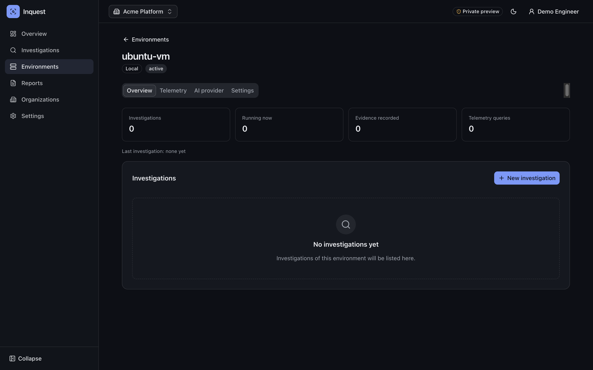
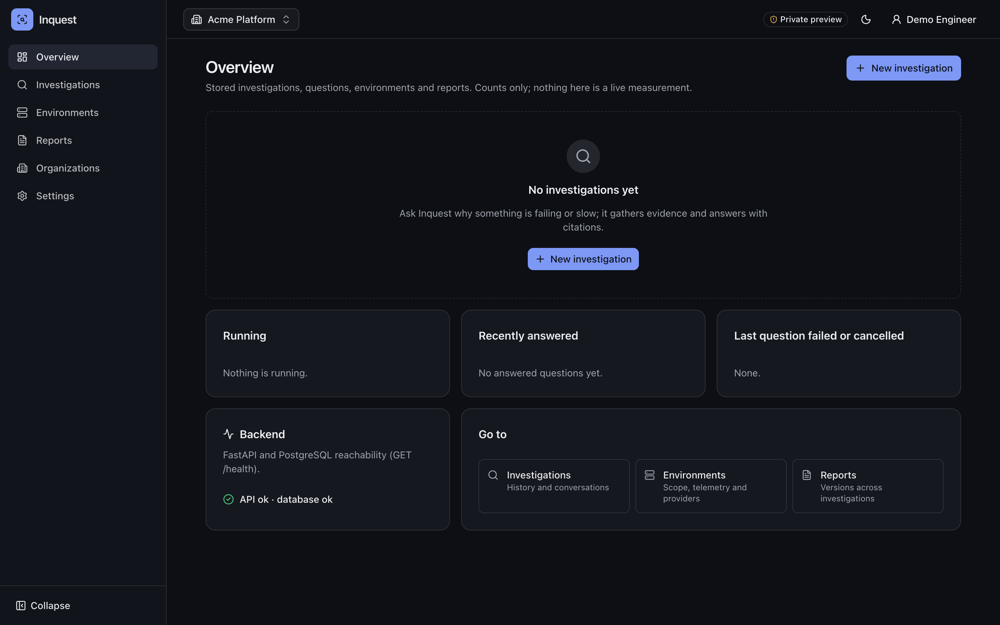
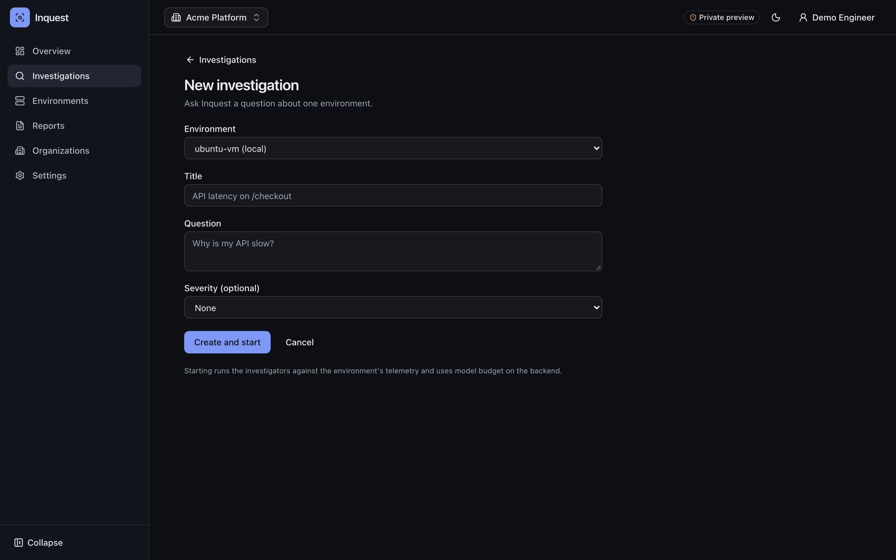
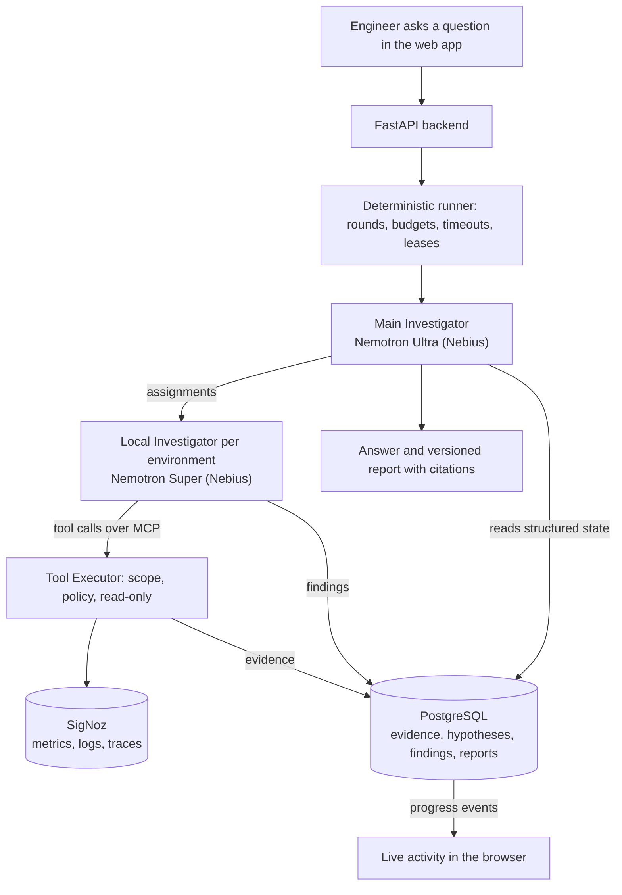

# Inquest

**Inquest is an autonomous infrastructure investigator.** Ask it why something broke ("why
are users getting 500s from checkout?") and it investigates the way an on-call engineer
does: it forms hypotheses, runs targeted queries against your telemetry, records evidence,
tests and discards hypotheses, and answers with a root-cause report in which every claim
links back to the evidence behind it. You can then ask follow-up questions in the same
investigation.

The reasoning is done by **NVIDIA Nemotron models on Nebius Token Factory**. The evidence
comes from **SigNoz** (OpenTelemetry metrics, logs and traces). Everything the
investigators find is stored in **PostgreSQL** as investigation memory.

Inquest is an investigation system, not an observability platform. It never copies your
telemetry into its own database and never sends all of it to a model. It asks specific
questions and keeps the answers.



| Overview | New investigation |
| --- | --- |
|  |  |

## How it works



Two levels of reasoning, with deterministic code in between:

1. **Main Investigator** (Nemotron Ultra). Plans the investigation, assigns work to
   environment investigators, reads their structured findings from PostgreSQL, correlates
   them, asks for follow-up work if needed and writes the answer and report. It never
   queries infrastructure itself.
2. **Local Investigator** (Nemotron Super), one per environment. It forms hypotheses and
   calls tools (`signoz.trace_stats`, `signoz.search_spans`, `signoz.get_trace`,
   `signoz.search_logs`, `signoz.log_volume`, `signoz.query_metrics`). It records
   evidence, updates hypotheses and reports findings.

What the models may do is decided by code, not by the models:

- **Tool Executor.** Every tool call goes through an MCP server and a deterministic
  executor. The executor validates arguments, forces the environment's telemetry scope
  (hosts and services) onto every query, limits time ranges and result sizes, removes
  secrets from results and stores each result as evidence. All tools are read-only.
- **Budgets and lifecycle.** The runner owns rounds, tool-call and token budgets,
  timeouts, retries, cancellation and crash recovery (LangGraph checkpoints in
  PostgreSQL).
- **Grounded answers.** Answers and reports may only cite evidence, findings and
  hypotheses that exist. The backend validates every reference and refuses unsupported
  root-cause claims, and "inconclusive" is an accepted outcome. Charts and numbers in the
  UI are built from stored evidence by deterministic code, never from model text.
- **Follow-ups.** Each new question is a turn of the same investigation. Main decides
  whether stored memory answers it or new evidence is needed. The report is revised as
  a new version, and earlier versions stay.

### Nemotron on Nebius Token Factory

Inquest talks to Nebius Token Factory through its OpenAI-compatible Chat Completions API
(`https://api.tokenfactory.nebius.com/v1/`), with LangGraph orchestrating the agents.

| Role | Default model | Why |
| --- | --- | --- |
| Main Investigator | `nvidia/Nemotron-3-Ultra-550b-a55b` | Planning, correlation and report writing over structured state |
| Local Investigator | `nvidia/nemotron-3-super-120b-a12b` | Many fast tool-calling steps per environment |

Model output that must be machine-read (plans, findings, reports) uses JSON-schema
structured output and is validated before anything is stored. Models are configured per
environment in the UI, and the API key is stored encrypted.

### The web app

React + TypeScript (Vite, Tailwind, shadcn/ui, TanStack Query):

- live investigation activity streamed from the backend (Server-Sent Events);
- answers rendered from validated blocks, with clickable citations that open the
  underlying evidence;
- report history;
- organizations and invitations;
- per-environment AI provider and telemetry settings.

Sign-in uses OpenID Connect handled by the backend: HttpOnly session cookies, CSRF
protection, and no tokens in the browser.

## Quick start (local)

The quickest way to run Inquest is on your own machine.

**Prerequisites:**

- Python 3.12 with [uv](https://docs.astral.sh/uv/);
- Node 22+ with Corepack (for pnpm);
- Docker;
- a Nebius Token Factory API key;
- a SigNoz instance receiving OpenTelemetry data from some service (self-hosted SigNoz
  works; send traffic, including some errors, so there is something to investigate).

```bash
cp .env.example .env
```

Edit `.env`:

- `POSTGRES_PASSWORD`: any local value.
- `INQUEST_RUNNER_ENABLED=true`
- Sign-in through the bundled local mock provider:
  - `INQUEST_AUTH_ISSUER=http://localhost:8090/default`
  - `INQUEST_AUTH_CLIENT_ID=inquest-local`
  - `INQUEST_AUTH_CLIENT_SECRET=` any value
  - `INQUEST_AUTH_COOKIE_SECURE=false`
- Credential encryption keys. Generate each with
  `uv run python -c "import base64, os; print(base64.b64encode(os.urandom(32)).decode())"`:
  - `INQUEST_CREDENTIAL_KEYS={"k1":"<key>"}`
  - `INQUEST_CREDENTIAL_ACTIVE_KEY=k1`
  - `INQUEST_CREDENTIAL_FINGERPRINT_KEY=<a different key>`
- For a local SigNoz: `INQUEST_TELEMETRY_ALLOWED_ORIGINS=["http://localhost:8080"]`.

Then start everything:

```bash
docker compose --profile demo up -d        # PostgreSQL + local mock sign-in
uv sync
uv run alembic upgrade head
uv run uvicorn src.main:app --port 8000    # API (MCP tool server starts on 127.0.0.1:8001)

cd web
corepack enable pnpm
pnpm install
pnpm dev                                   # http://localhost:5173
```

In the browser:

1. **Sign in.** The mock provider's form accepts any username. Put
   `{"email": "you@example.com", "email_verified": true}` in its claims box.
2. **Create an organization**, then an **environment**. Enter the service names and
   host names your telemetry uses; Inquest only ever queries inside this scope.
3. On the environment's **AI provider** tab, enter your Nebius API key and models. On
   the **Telemetry** tab, enter your SigNoz URL and API key. Both are checked before
   they are saved.
4. Start a **new investigation** with a question. Watch the live activity, read the
   cited answer and report, then ask a follow-up.

## Tests

The same checks run in GitHub Actions (`.github/workflows/ci.yml`) on every push. They
call no model or telemetry provider.

```bash
# Backend: needs the PostgreSQL from docker compose; the test database is created on
# first start and runs as least-privilege roles provisioned by the suite.
APP_ENV=test uv run alembic upgrade head
uv run pytest
uv run ruff check . && uv run ruff format --check .

# Frontend
cd web && pnpm lint && pnpm typecheck && pnpm test && pnpm build
```

## Repository layout

```
src/
  api/             FastAPI routes, SSE, security middleware
  auth/            OIDC sign-in, sessions, admission
  investigators/   LangGraph Main and Local Investigators, runner, prompts, validation
  mcp_server/      MCP tool server (loopback only)
  tools/           Tool Executor: scope, policy, sanitizing, evidence
  integrations/    SigNoz client and query builders
  credentials/     encrypted per-environment credentials, destination policy
  services/        investigations, reports, presentation, organizations, limits
  models/          SQLAlchemy models (PostgreSQL)
migrations/        Alembic migrations
web/               React frontend
deploy/            reference container topology (TLS proxy, private API, local e2e checks)
scripts/           operator commands (admission, key rotation, database roles)
tests/             backend tests
```

## Security model, in short

- Models choose what to investigate; deterministic code decides what runs. There are only
  read-only tools, with a forced telemetry scope, and no shell or secrets in model
  context.
- Data belongs to organizations. Every route checks membership, and records outside it
  answer 404.
- Provider credentials are per environment, encrypted at rest and write-only (never
  returned). Outbound requests go only to allowlisted destinations.
- The app runs as a least-privilege database role. It enforces rate limits and quotas,
  signs users in through OIDC with server-side sessions, and supports sign-out everywhere
  and operator account suspension.

## Status

Built for a hackathon (October 2026):

- The SigNoz investigator is complete. The AWS/CloudWatch investigator is designed but
  not built yet.
- Inquest is meant to run self-hosted, for one team.
- The multi-tenant hosting configuration in `deploy/` is a reference that has been
  validated locally. It has not yet been operated as a public service.

## License

[MIT](LICENSE)
